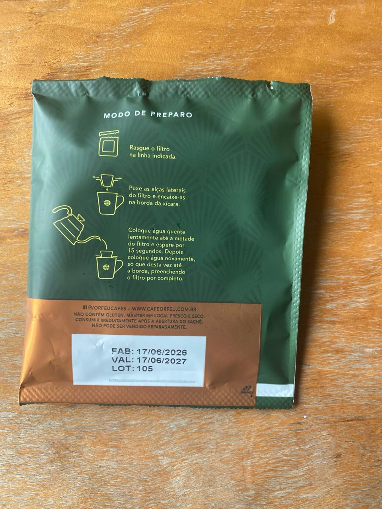
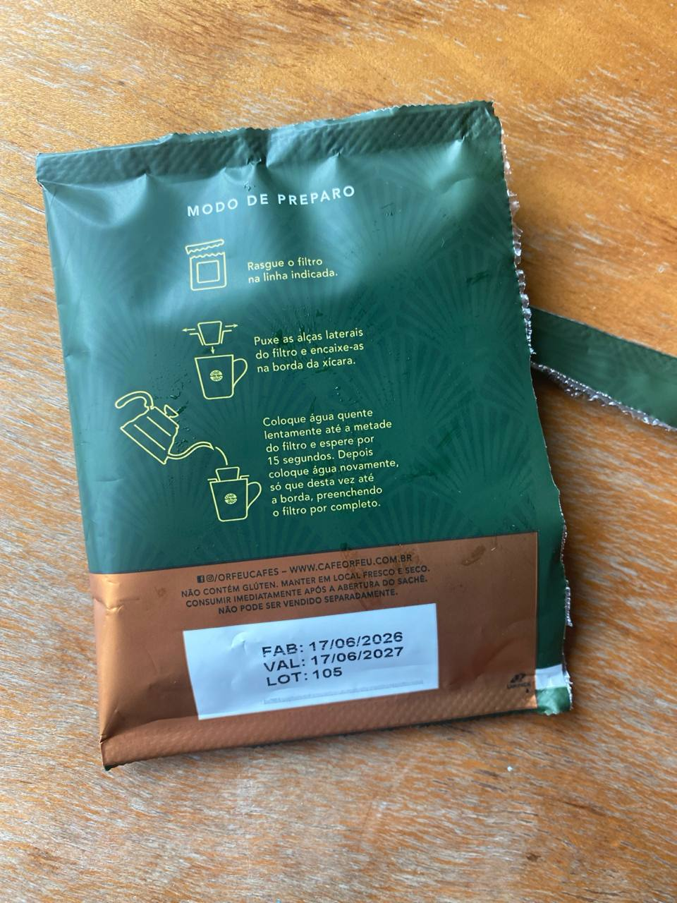
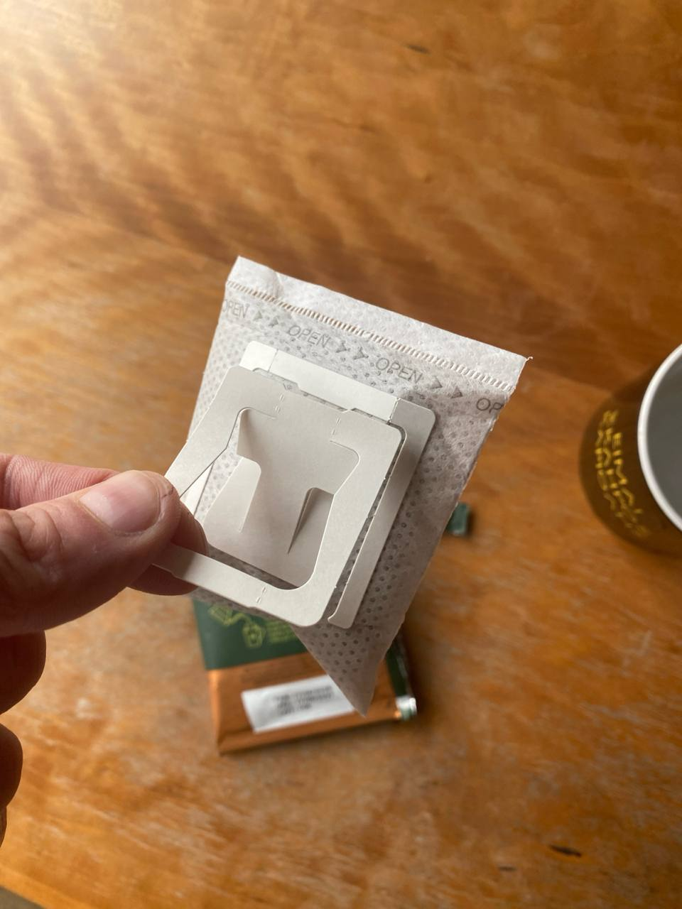
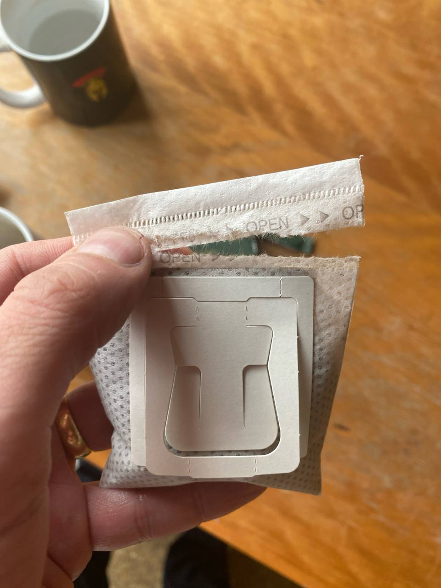
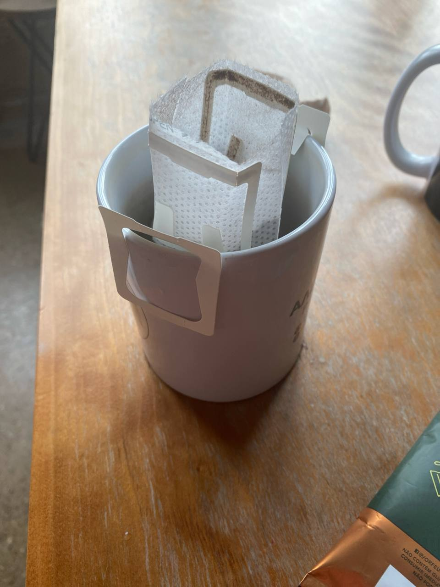
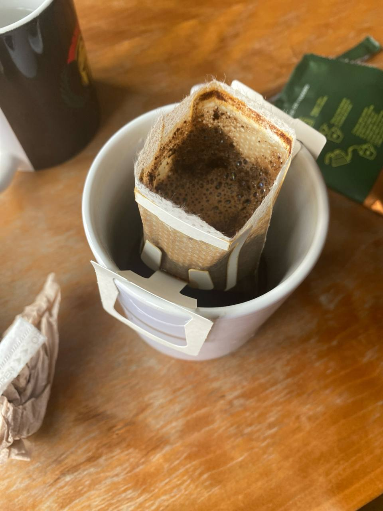
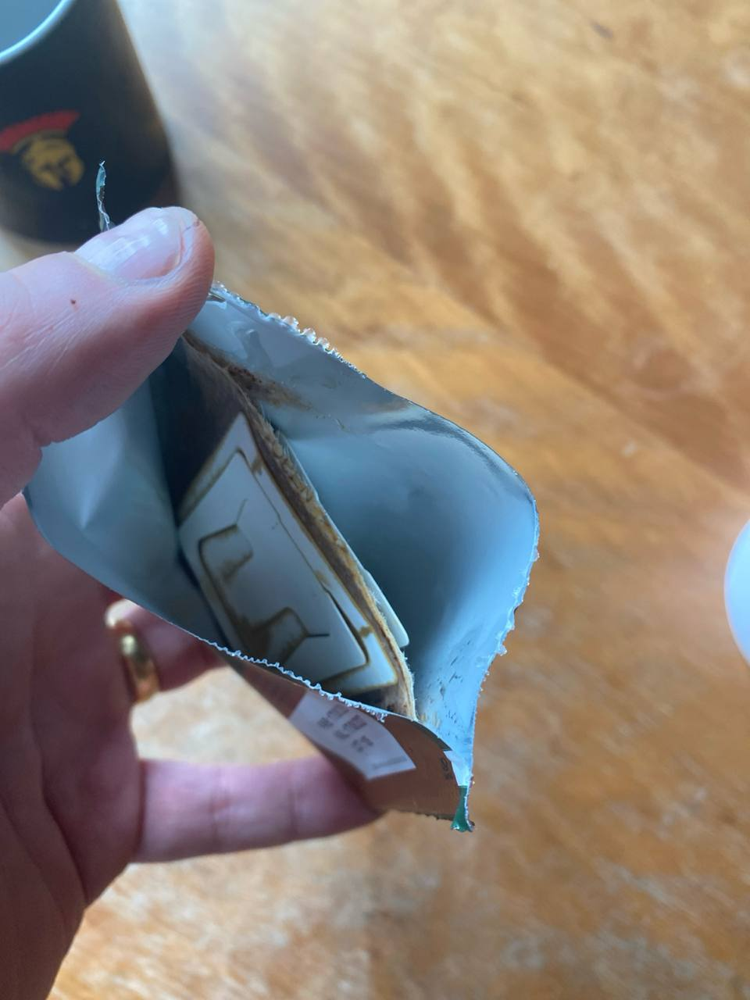

# How to Use these Brazilian Coffee Bags

A visual guide as I give the same bags to different people.

Takes a bit but replicates the "real thing".

There is a small cut top right, cut linearly there.

Then looks like this.

Hold these white "holders", these will go to the glass, stabilise them.

Cut the top, says "open" - oddly enough in 🏴󠁧󠁢󠁥󠁮󠁧󠁿.

Attach to a cup like this so that water can be poured.

Pour little bits of boiling water. Can be 2x max 3x times. At that point the powder becomes "cemented" with more not being able top pass through.

That's it. Can wrap everything up for the bin/recycling  bin.

